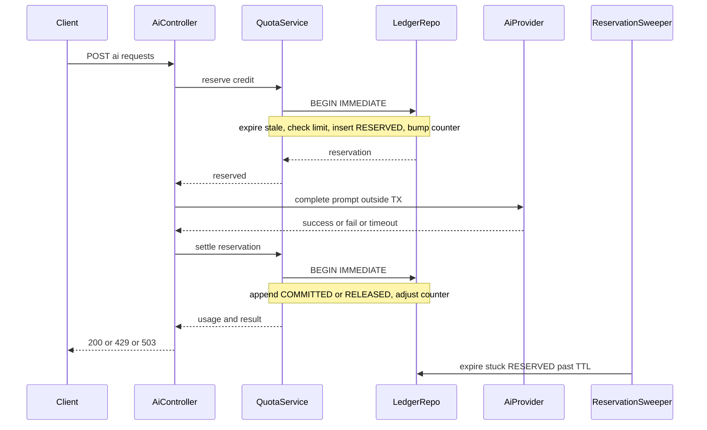

# Design: AI Usage Metering & Quota System

## 1. Architecture

Components:

- **HTTP layer** (`api/`): NestJS controllers and DTOs for AI requests, usage queries, and admin limit overrides. Global validation pipe and structured JSON logging with `request_id`.
- **Quota service** (`quota/`): owns reserve → execute → settle orchestration, limit resolution, period identity, and TTL expiry.
- **Ledger repository** (`ledger/`): append-only SQLite store, counter cache, immutability triggers, reconcile.
- **AI provider** (`ai/`): injectable simulator (delay + failure rate + hard timeout). No retries.
- **Config** (`config/`): fail-fast env schema (`DEFAULT_LIMIT`, `PERIOD`, AI knobs, TTL, `DB_PATH`, `PORT`).
- **Clock** (`common/`): injectable time source so tests can roll periods and expire reservations.
- **Sweeper**: periodic job that releases stuck `RESERVED` rows past TTL.

Request flow never holds a DB transaction across the AI `await`. Reserve and settle are separate `BEGIN IMMEDIATE` transactions. On storage failure the API fails closed with 503 so unmetered AI calls are never served.

## 2. Data model

### `usage_ledger` (append-only)

| Field | Purpose |
| --- | --- |
| `usage_id` | Primary key for each evidence row |
| `user_id` | Who consumed / attempted |
| `idempotency_key` | Dedup client retries (`UNIQUE(user_id, idempotency_key)` for the reserve row) |
| `request_id` | Correlate logs and dispute traces |
| `period_id` | Billing window at reserve time (`YYYY-MM-DD` daily or `YYYY-MM` monthly, UTC) |
| `status` | `RESERVED`, `COMMITTED`, `RELEASED`, `REJECTED_QUOTA` |
| `reservation_id` | Links settle/release events to the reserve event |
| `credits` | Cost (1 for reserve/commit paths that consume; 0 for reject/release accounting rows as needed) |
| `limit_at_time_of_use` | Snapshot of effective limit for audit when X changes mid-period |
| `created_at` / `settled_at` | Server/`Clock` UTC only |
| `ai_outcome`, `latency_ms`, `error_code` | AI result evidence |
| `request_hash` | Detect same idempotency key with different payload |
| `expire_at` | When a `RESERVED` row becomes stale |
| `release_reason` | e.g. `ai_failure`, `ai_timeout`, `ttl_expired`, `late_ignored` |

SQLite triggers reject `UPDATE`/`DELETE` on the ledger. State changes are new rows. A partial unique index on `(reservation_id)` where status is `COMMITTED` or `RELEASED` prevents double-settlement.

### Derived tables

- **`quota_counters(user_id, period_id, used)`**: rebuildable cache of `COMMITTED + non-expired RESERVED`.
- **`user_limits(user_id, limit_override)`**: optional per-user overrides; else `DEFAULT_LIMIT`.
- **`idempotency_index`**: maps `(user_id, idempotency_key)` → reservation + cached response payload for replays.

## 3. Quota enforcement

1. **RESERVE** (one `BEGIN IMMEDIATE` TX): expire stale reservations for the user/period; resolve limit; if idempotency hit, return cached outcome; if `used >= limit`, append `REJECTED_QUOTA` (credits 0) and return 429; else insert `RESERVED`, bump counter, store hash/response stub.
2. **EXECUTE**: call simulated AI outside any TX (random delay, failure rate, hard timeout). No retries.
3. **SETTLE** (separate TX): if reservation already terminal, no-op (idempotent). On success append `COMMITTED` (counter stays). On failure/timeout append `RELEASED` and decrement counter. Partial unique index + status check prevent late double-settle after TTL release.

Counter invariant: `used = count(COMMITTED) + count(non-expired RESERVED)` for the period. `RELEASED` and `REJECTED_QUOTA` do not count. `npm run reconcile` verifies and reports drift.

## 4. Edge cases

| Edge case | Handling |
| --- | --- |
| N parallel at last credit | `BEGIN IMMEDIATE` serializes; exactly one reserves |
| Client retries | Same `Idempotency-Key` returns original result; no extra charge |
| Same key, different payload | 409 Conflict |
| AI failure | `RELEASED`; evidence kept; credit returned |
| AI timeout + late result | Timeout releases; late settle sees terminal and skips |
| Crash between reserve and settle | TTL + lazy expiry + sweeper release with `ttl_expired` |
| Period boundary | Fixed UTC window; billed to period of reserve |
| Limit raise/lower mid-period | New limit immediate; lower never deletes history; snapshot stored |
| Per-user override | `user_limits` wins over `DEFAULT_LIMIT` |
| Unknown user | Auto-create (counter row appears on first reserve) |
| Invalid input / bad config | 400 validation; process exits on bad env |
| Clock skew / multi-instance | Server/`Clock` only; SQLite single writer |
| Limit 0 / huge / negative | Config and DTO validation |
| Idempotency across periods | Unique per user globally; replay returns original |
| Usage while in flight | Pending = non-expired `RESERVED`; remaining = limit − used − pending |
| Ledger tampering | Triggers block UPDATE/DELETE; hash-chain not implemented |
| Refund semantics | Failed calls not billed but evidenced via `RELEASED` |
| Rate-limit vs quota | Quota is credit budget; abuse rate-limits are out of scope |

## 5. Failure handling

- **DB locked/down/slow**: fail closed with 503; do not call AI without a reservation.
- **AI down/slow**: hard timeout → release; no automatic retries that could double-charge.
- **Settle write fails after AI success**: leave `RESERVED` until sweeper or client retry with same idempotency key; production would add an outbox. Documented limitation: rare settle failure after success may temporarily show pending until TTL/retry.
- **Graceful shutdown**: stop accepting new work, wait briefly for in-flight, leave unsettled `RESERVED` for sweeper; exec-form Docker `CMD` so `SIGTERM` reaches Node.

## 6. Scaling

This implementation is single-process SQLite (one Docker replica). Production path:

- Stateless API replicas; shard by `user_id`.
- Postgres `UPDATE ... WHERE used < limit RETURNING` or Redis Lua for hot counters; ledger remains source of truth.
- Partition ledger by time/user; Kafka for cold archival.
- Read replicas for usage GETs; rebuild counters from ledger after incidents.
- Multi-region: sticky routing per user or CRDT-unfriendly counters with a single home region.

## 7. Trade-offs

| Chosen | Rejected | Why |
| --- | --- | --- |
| Reserve/settle | Charge-after | Charge-after can overshoot under concurrency |
| Reserve/settle with refund | Charge-before without refund | Unfair when AI fails |
| SQLite TX | Distributed lock | Sufficient for local take-home; simpler |
| Counter cache | `COUNT(*)` every request | Hot path latency; reconcile catches drift |
| Fixed UTC window | Rolling window | Simpler period_id, clearer billing boundaries |
| Fail-closed | Fail-open | Billing integrity > availability for this domain |
| Sync ledger write | Async ledger | Evidence must exist before AI for auditability of attempts |
| NestJS | Next.js / plain Node | Clear DI for Clock/AI fakes; no UI needed |
| SQLite | Postgres/Redis | Assignment asks local storage only |

**Docker note:** run exactly one container replica with a volume-mounted DB path. Scaling out requires Postgres/Redis as above.
